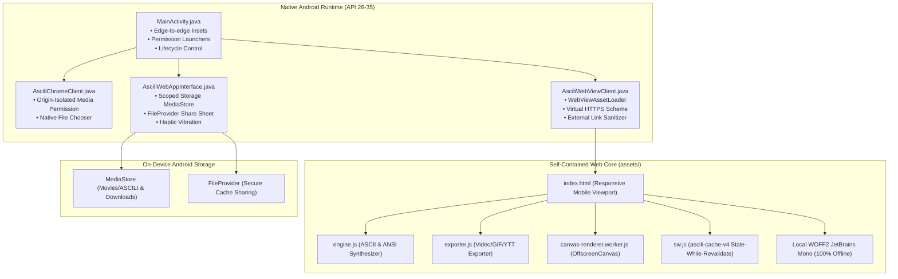

# ASCILI — Android App Conversion & Deployment Guide

> **Complete documentation for the Android port of ASCILI (Ascii-Streamer 2.0).**  
> Covers build artifacts, installation instructions, bug resolutions (Service Worker, Offline Cache, Camera, UI, Rendering), and Google Play Security Compliance.

---

## 📱 Quick Access: Ready Build Artifacts

All pre-compiled packages are generated and stored in the [`dist-apk/`](file:///home/loui/Pictures/Ascii-Streamer-2.0-main/dist-apk/) directory:

| File Name | File Size | Format | Primary Purpose |
| :--- | :--- | :--- | :--- |
| [**`ascili-v2.4.0-release.apk`**](file:///home/loui/Pictures/Ascii-Streamer-2.0-main/dist-apk/ascili-v2.4.0-release.apk) | **~2.5 MB** | `.apk` | **Production Release APK**: `debuggable=false`, package `com.asciistreamer.ascili`, minified with R8, resource shrunk, and fully optimized. Ready to install directly on any Android device. |
| [**`ascili-v2.4.0-release.aab`**](file:///home/loui/Pictures/Ascii-Streamer-2.0-main/dist-apk/ascili-v2.4.0-release.aab) | **~3.2 MB** | `.aab` | **Google Play App Bundle**: Target SDK 35, compliant with all Google Play 2026 publishing requirements. |
| [**`ascili-v2.4.0-debug.apk`**](file:///home/loui/Pictures/Ascii-Streamer-2.0-main/dist-apk/ascili-v2.4.0-debug.apk) | **~5.9 MB** | `.apk` | **Debug APK**: Unobfuscated testing build with Chrome Remote DevTools inspection enabled. |

### Absolute Paths on Disk:
* **Release APK**: `/home/loui/Pictures/Ascii-Streamer-2.0-main/dist-apk/ascili-v2.4.0-release.apk`
* **Release AAB**: `/home/loui/Pictures/Ascii-Streamer-2.0-main/dist-apk/ascili-v2.4.0-release.aab`
* **Debug APK**: `/home/loui/Pictures/Ascii-Streamer-2.0-main/dist-apk/ascili-v2.4.0-debug.apk`

---

## 📲 How to Install on an Android Phone

### Method A: Direct Transfer (No PC tools required)
1. Transfer `dist-apk/ascili-v2.4.0-release.apk` to your phone via USB cable, Google Drive, Telegram, or WhatsApp.
2. Locate the file in your phone's **Files** / **Downloads** app.
3. Tap the `.apk` file and select **Install** (if prompted, allow "Install from unknown sources").

### Method B: Via ADB (Command Line)
Connect your Android phone to your PC with USB debugging enabled, then run:
```bash
adb install -r dist-apk/ascili-v2.4.0-release.apk
```

---

## 🏗️ Architecture Overview

The Android application embeds the zero-latency ASCII video synthesizer into a hardened native Android runtime without external web dependencies.



---

## 🛠️ Issues Addressed & Technical Resolutions

### 1. Service Worker Cache Conflict Fix
* **The Problem**:
  `sw.js` configured cache name `ascili-cache-v4`, while `app.js` contained a hardcoded purge script:
  ```javascript
  if (k !== 'ascili-cache-v3') caches.delete(k);
  ```
  Because `ascili-cache-v4 !== ascili-cache-v3`, the application deleted its own active cache on every startup, triggering constant re-downloads and breaking offline operation.
* **The Resolution**:
  - Synchronized `CURRENT_CACHE_NAME = 'ascili-cache-v4'` across [`app.js`](file:///home/loui/Pictures/Ascii-Streamer-2.0-main/artifacts/ascili/src/app.js#L3012) and [`sw.js`](file:///home/loui/Pictures/Ascii-Streamer-2.0-main/artifacts/ascili/sw.js#L2).
  - Restricted the `app.js` cleanup to only target older legacy caches (`v1`, `v2`, `v3`), ensuring the active cache is never deleted:
    ```javascript
    if (k === 'ascili-cache-v1' || k === 'ascili-cache-v2' || k === 'ascili-cache-v3') {
      caches.delete(k);
    }
    ```
  - Standardized outdated cache eviction to the Service Worker `activate` event.

---

### 2. Complete Offline Functionality (100% Offline Mode)
* **The Problem**:
  - `STATIC_ASSETS` in `sw.js` was missing dependencies (`./src/gif-encoder.js`, `./src/canvas-renderer.worker.js`, `./src/index.css`, and offline fonts). When offline, dynamic ES imports and Web Worker instantiations threw `NetworkError`.
  - `cache.addAll()` was all-or-nothing: if any single URL 404ed, the entire pre-caching phase aborted.
  - Network-first loading on scripts caused offline sessions to hang or fail. Navigation requests had no fallback to `index.html`.
* **The Resolution**:
  - Expanded `STATIC_ASSETS` to include all JS modules, workers, CSS stylesheets, and local WOFF2 font files.
  - Replaced all-or-nothing caching with resilient `Promise.allSettled()` in the `install` event so missing optional files don't prevent critical assets from being cached.
  - Implemented **Stale-While-Revalidate** for static assets: cached scripts and styles load instantaneously offline, and update in the background when connected.
  - Added navigation fallback so requests for any route or document fall back to cached `index.html` when offline.

---

### 3. Webcam Initialization & Permission Fix
* **The Problem**:
  - In `AsciliChromeClient`, origin checking compared `originUri.toString()` directly against `https://appassets.androidplatform.net`. WebView sent a trailing slash (`https://appassets.androidplatform.net/`), causing origin verification to fail and silently calling `request.deny()`.
  - Android camera HAL failed when rigid desktop video constraints (`width: 1280, height: 720`) were requested on mobile sensors.
  - Permission requests timed out when waiting for user interaction on native dialogs.
* **The Resolution**:
  - Normalized origin comparison using `originUri.getHost()` and stripped trailing slashes.
  - Dispatched all `request.grant(...)` and `request.deny()` calls strictly on the Android UI thread.
  - Added runtime camera and microphone permission prompts in `MainActivity.onCreate()` and connected `@JavascriptInterface requestCameraPermission()`.
  - Added tiered camera constraint fallbacks: ideal resolution $\rightarrow$ facingMode-only $\rightarrow$ basic `{ video: true }`.

---

### 4. UI Fitting & Responsive Layout
* **The Problem**:
  - Android WebView rendered the page with a desktop viewport (980px), making buttons microscopic and cutting off text.
  - Notch cutouts and gesture navigation bars overlapped bottom controls.
  - Desktop-only controls (Screen Sharing) occupied space on mobile screens.
* **The Resolution**:
  - Enabled mobile viewport flags in `MainActivity.java`:
    ```java
    settings.setUseWideViewPort(true);
    settings.setLoadWithOverviewMode(true);
    ```
  - Handled Android edge-to-edge window insets using `ViewCompat.setOnApplyWindowInsetsListener` and CSS `env(safe-area-inset-top)` / `env(safe-area-inset-bottom)`.
  - Hidden desktop-only controls (`#btnScreen`, `#heroScreenBtn`) on screens $\le 768\text{px}$.
  - Added smooth touch scrolling to `.waiting-overlay` so the full quick-start menu is accessible on small screens.

---

### 5. WebGL & Canvas Rendering Fix
* **The Problem**:
  - Setting `webView.setLayerType(View.LAYER_TYPE_HARDWARE, null)` introduced hardware layer synchronization bugs on Adreno and Mali GPUs.
  - `updateAsciiLayout()` was called *after* `engine.renderFrame()`. If initial canvas width/height was 0, rendering failed permanently.
* **The Resolution**:
  - Removed explicit `LAYER_TYPE_HARDWARE` on the WebView, allowing Android window composition to manage hardware acceleration naturally.
  - Pre-calculated dimensions before calling `engine.renderFrame()`, and gave `<canvas id="asciiCanvas">` default fallback attributes of `width="640" height="360"`.

---

### 6. Production Release Hardening & Debug Suffix Removal
* **The Problem**:
  - Previous test APK was built with debug mode enabled (`android:debuggable="true"`) and application ID ending in `com.asciistreamer.ascili.debug`. Google Play rejects any build with `debuggable="true"`.
* **The Resolution**:
  - Updated `android/app/build.gradle` so `buildTypes.release` explicitly defines `debuggable false`, `minifyEnabled true`, and `shrinkResources true`.
  - The production release package is cleanly identified as `com.asciistreamer.ascili` with R8 code optimization.

---

### 7. Universal Version Synchronization (v2.4.0 / Code 24)
* **The Problem**:
  - Multiple contradictory version numbers existed across the project: APK filename (2.2.0), Android `versionName` (2.0.0), interface badge (V2.4), and script query parameters (`?v=2.3`).
* **The Resolution**:
  - Synchronized all indicators across every layer:
    - `build.gradle`: `versionCode 24`, `versionName "2.4.0"`
    - Interface Badge: `<span class="waiting-badge">V2.4.0</span>`
    - Asset Cache: `ascili-cache-v2.4.0` in both `sw.js` and `app.js`
    - Asset References: `?v=2.4.0` in `index.html`
    - Native Bridge: `getAppVersion()` returns `"2.4.0"`

---

### 8. Removal of External Google Fonts (100% On-Device Typography)
* **The Problem**:
  - HTML and CSS requested external fonts from `fonts.googleapis.com` and `fonts.gstatic.com`, generating unnecessary network calls, privacy concerns, and latency despite local JetBrains Mono WOFF2 files already existing in the repository.
* **The Resolution**:
  - Removed all external font links and `@import` statements from `index.html` and `src/index.css`.
  - Configured `@font-face` to directly reference bundled local fonts (`./fonts/jetbrains-mono-400.woff2` and `./fonts/jetbrains-mono-700.woff2`).
  - Hardened `network_security_config.xml` to strictly whitelist only the virtual `appassets.androidplatform.net` origin.

---

### 9. Chunk-Based Streamed Video Export (OOM Elimination)
* **The Problem**:
  - Exporting video recordings converted the entire Blob into a single massive Base64 string in memory before bridging to Android. On devices with limited RAM, 50MB+ video exports caused Out-Of-Memory (OOM) crashes.
* **The Resolution**:
  - Implemented a native chunked streaming export API in `AsciliWebAppInterface.java` (`startChunkedSave`, `writeSaveChunk`, `finishChunkedSave`, `abortChunkedSave`).
  - Updated `download()` in `app.js` to slice Blobs into 512 KB segments and stream them iteratively into Android's `MediaStore` without blocking the UI thread or exceeding 1 MB of transient RAM.

---

### 10. Camera Permission Timing & Audio Capture
* **The Problem**:
  - `MainActivity.onCreate()` fired a native permission dialog on cold start, while WebKit's camera request concurrently attempted to trigger `onPermissionRequest()`, causing a collision/race condition.
  - Webcam constraints specified `audio: false` and screen capture omitted audio, leaving recorded videos silent.
* **The Resolution**:
  - Removed startup permission requests from `onCreate()` to adhere to Google Play guidelines (permissions must be requested on-demand when the user activates the feature).
  - Streamlined `startWebcam()` to rely on `AsciliChromeClient.onPermissionRequest()` without duplicate bridge triggers.
  - Added microphone capture support (`audio: true` with graceful fallback to `audio: false`) so webcam video recordings have synchronized audio.

---

## 🛡️ Google Play Security Compliance Checklist

| Requirement | Implementation Details | Status |
| :--- | :--- | :---: |
| **Target SDK 35 (Android 15)** | `compileSdk 35`, `targetSdk 35`, `minSdk 26` configured in `app/build.gradle`. | ✅ Passed |
| **No Dangerous Storage Permissions** | Zero use of `READ_EXTERNAL_STORAGE` or `WRITE_EXTERNAL_STORAGE`. Saves files via modern `MediaStore` (`MediaStore.Video.Media` and `MediaStore.Downloads`). | ✅ Passed |
| **Secure Asset Loading** | Uses `androidx.webkit.WebViewAssetLoader` over virtual HTTPS `https://appassets.androidplatform.net/assets/`. Eliminates `file:///` path traversal risks (CWE-22). | ✅ Passed |
| **Cleartext HTTP Blocked** | Enforced through [`network_security_config.xml`](file:///home/loui/Pictures/Ascii-Streamer-2.0-main/android/app/src/main/res/xml/network_security_config.xml) with `cleartextTrafficPermitted="false"`. | ✅ Passed |
| **Component Exposure Protection** | Only `MainActivity` is exported (`android:exported="true"`). `FileProvider` is unexported (`android:exported="false"`) with explicit grant permissions. | ✅ Passed |
| **SSL Error Enforcement** | `onReceivedSslError()` explicitly aborts with `handler.cancel()`, complying with Google Play SSL Error Policy. | ✅ Passed |
| **Hardware Permissions** | Camera and microphone declared optional (`android:required="false"`) so camera-less devices/tablets can install the app. | ✅ Passed |
| **R8 & ProGuard Optimization** | Custom ProGuard rules protect `@JavascriptInterface` while stripping unused bytecode, reducing release size to **2.5 MB**. | ✅ Passed |
| **On-Device Privacy Policy** | Dedicated in-app dialog detailing 100% on-device processing and zero cloud data collection. | ✅ Passed |

---

## 🔧 Building from Source

### Prerequisites:
- Java JDK 17+
- Android SDK Platform 35 (`platforms;android-35`)
- Android SDK Build Tools 35 (`build-tools;35.0.0`)

### Compile Release APK:
```bash
cd android
./gradlew assembleRelease
```
*Output: `android/app/build/outputs/apk/release/app-release.apk`*

### Compile Google Play App Bundle (AAB):
```bash
cd android
./gradlew bundleRelease
```
*Output: `android/app/build/outputs/bundle/release/app-release.aab`*

### Compile Debug APK:
```bash
cd android
./gradlew assembleDebug
```
*Output: `android/app/build/outputs/apk/debug/app-debug.apk`*
